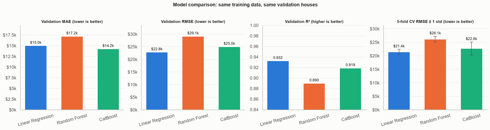
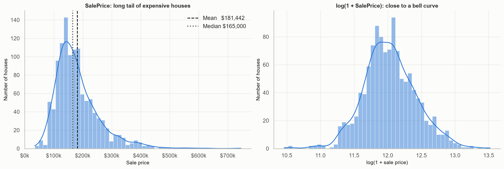
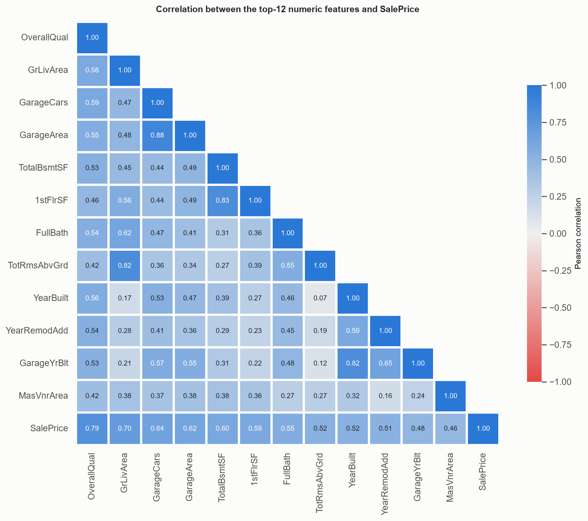
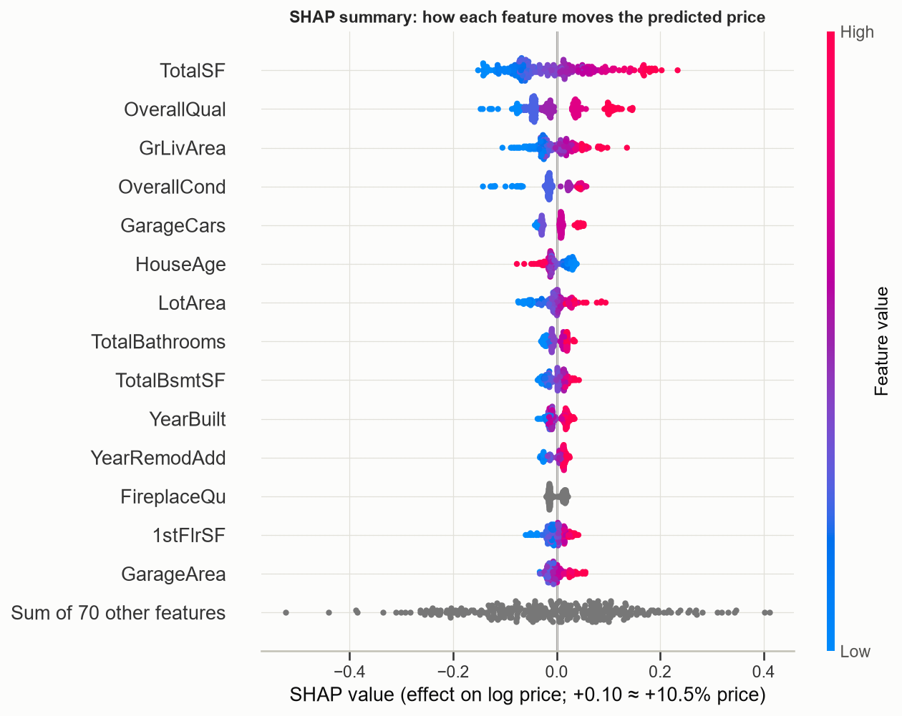

# House Price Prediction — Ames Housing Dataset

Predicting residential house prices from property characteristics with **Linear Regression, Random Forest and CatBoost**,
comparing them with leak-free pipelines and cross-validation, tuning the winner, and explaining its predictions with **SHAP**.

[](https://colab.research.google.com/github/yeskabyl/house-price-prediction/blob/main/notebooks/house_price_prediction.ipynb)


---

## Project overview

An end-to-end machine-learning project in a single Jupyter notebook that runs on Google Colab's free tier. It is
beginner-friendly but follows professional practice. It covers the full workflow: exploratory data analysis,
leak-free preprocessing with scikit-learn pipelines, feature engineering, a fair comparison of three regression
algorithms (5-fold cross-validation plus a held-out validation set), hyperparameter tuning, model explanation with SHAP,
and a reusable `predict_house_price()` function backed by the saved model. Every important decision is explained in
the notebook.

**Headline result:** on 292 houses it never saw during training or tuning, the final **tuned CatBoost** model has a
mean absolute error of **\$14,246**, explains **92%** of the price variation (R² = 0.921) and prices **76.7%** of houses
within **±10%** of their actual sale price.

## Problem statement

Buyers, sellers, agents, lenders and tax assessors all need a fair estimate of what a house is worth. Manual appraisals
based on "comparable sales" are slow, costly and inconsistent. This project builds a **supervised regression model**
that predicts the sale price (USD) of a house from 79 characteristics such as size, quality, age and location, and
explains *why* it predicts that price.

## Dataset

| | |
|---|---|
| **Source** | [Kaggle – House Prices: Advanced Regression Techniques](https://www.kaggle.com/competitions/house-prices-advanced-regression-techniques/data) (Ames Housing data, Dean De Cock, 2011) |
| **Used file** | `train.csv`: 1,460 house sales in Ames, Iowa (2006–2010), 79 features + `SalePrice` |
| **Target** | `SalePrice` in US dollars (median \$163,000, range \$34,900 – \$755,000) |
| **Not used** | `test.csv` has no prices, so it cannot be used to measure accuracy |

**Loading:** the notebook uses `data/train.csv` if you downloaded it from Kaggle. Otherwise it downloads the identical
table from [OpenML (dataset 42165)](https://www.openml.org/d/42165), which needs no Kaggle login. That's why it runs in Colab out of the box.
The Kaggle data is not redistributed in this repository.

## Technologies

Python · NumPy · Pandas · Matplotlib · Seaborn · scikit-learn (`Pipeline`, `ColumnTransformer`,
`TransformedTargetRegressor`, `RandomizedSearchCV`) · CatBoost · SHAP · Jupyter / Google Colab

## Project structure

```
house-price-prediction/
├── notebooks/
│   └── house_price_prediction.ipynb   # the complete, executed project notebook
├── models/
│   └── best_model.cbm                 # final tuned CatBoost model (predicts log(1 + price))
├── images/
│   ├── price_distribution.png
│   ├── correlation_heatmap.png
│   ├── model_comparison.png
│   └── shap_summary.png
├── README.md
└── requirements.txt
```

## Workflow

1. **Load** the data (local Kaggle `train.csv` or the OpenML mirror).
2. **Split** 80% training / 20% validation *before* exploring, so the validation houses stay unseen.
3. **EDA** on the training set: target distribution, numerical and categorical features, correlations, outliers, missing values.
4. **Preprocess:**
   - fixed domain rules: a missing `PoolQC` or `GarageType` means "no pool" or "no garage", so it becomes `"None"`;
   - remove two documented partial-sale outliers (training set only);
   - model `log(1 + price)` with `TransformedTargetRegressor`;
   - learned steps (median imputation, log transforms of skewed areas, scaling, one-hot encoding with rare-category grouping) go inside `Pipeline` + `ColumnTransformer`, so they are refit inside every CV fold.
5. **Engineer features:** `TotalSF`, `HouseAge`, `YearsSinceRemodel`, `TotalBathrooms`, `TotalPorchSF`.
6. **Train** Linear Regression, Random Forest and CatBoost on identical data, and compare them with 5-fold cross-validation on the same folds.
7. **Evaluate** on the validation set: MAE, RMSE, R², RMSLE and % within ±10%, plus actual-vs-predicted plots and residual analysis.
8. **Tune** CatBoost with `RandomizedSearchCV` (15 candidates × 5 folds, training data only).
9. **Explain** the model with CatBoost feature importance and SHAP (summary, waterfall and dependence plots).
10. **Deploy-ready:** retrain on all labelled data, save `models/best_model.cbm`, and provide `predict_house_price()` with what-if examples.

## Results

All numbers below were produced by running the notebook. They are not estimates.

| Model | Val MAE | Val RMSE | Val R² | Val RMSLE | Within ±10% | 5-fold CV RMSE | 5-fold CV MAE |
|---|---|---|---|---|---|---|---|
| Linear Regression | \$14,970 | **\$22,778** | **0.932** | 0.125 | 70.2% | **\$21,370** | \$14,332 |
| Random Forest | \$17,169 | \$29,089 | 0.890 | 0.147 | 68.8% | \$26,071 | \$16,525 |
| CatBoost (default) | **\$14,213** | \$24,967 | 0.919 | **0.124** | **76.7%** | \$22,643 | \$13,510 |
| **CatBoost (tuned) – final model** | \$14,246 | \$24,615 | 0.921 | 0.128 | **76.7%** | \$21,890 | **\$13,291** |

*Val* = held-out validation set (292 houses). *CV* = 5-fold cross-validation on the 1,166 training houses.



**Why CatBoost, when Linear Regression has the lower RMSE?** The two models are close and have different strengths:

- **Typical houses: CatBoost is more accurate.** It has the lower MAE in 4 of 5 CV folds and on the validation set, and 76.7% vs 70.2% of houses fall within ±10%.
- **Linear Regression's RMSE lead is fragile.** It comes from a few extreme houses, because tree models cannot predict above the most expensive training house. Without the single \$755k validation house, default CatBoost's RMSE drops from \$24,967 to \$21,678, below Linear Regression's \$22,406.
- **CatBoost needs almost no manual preprocessing.**

If pricing rare luxury homes were the priority, Linear Regression or a blend of both would be preferable. Section 8.2 of
the notebook discusses this trade-off.

## Evaluation metrics

| Metric | Meaning |
|---|---|
| **MAE** | Average absolute error in dollars: "on average the estimate is off by \$X". |
| **RMSE** | Like MAE but squares errors first, so large mistakes weigh much more. |
| **R²** | Share of the price variation explained by the model (1 = perfect, 0 = no better than the mean). |
| **RMSLE** | RMSE on log prices, the Kaggle leaderboard metric. Roughly the typical *percentage* error. |
| **Within 10%** | Share of houses whose estimate is within ±10% of the true price. |

## Key findings

- **The price is right-skewed** (skewness 1.74, and 0.12 after a log transform), so all models learn `log(price)`.
  Errors then behave like percentages.

  

- **Quality and size dominate.** `OverallQual` (r = 0.79) and `GrLivArea` (r = 0.70) have the strongest linear
  relationship with price. Several features are strongly inter-correlated, e.g. `GarageCars`/`GarageArea` with r = 0.88.

  

- **Outliers need judgement, not just rules.** Two huge houses sold far below value in *partial* sales. They were
  removed, but only from the training set. The IQR rule flags 48 expensive houses, and all are genuine sales, so they were kept.
- **Feature engineering paid off.** `TotalSF` (basement + floors) correlates more strongly with log price (0.82) than any
  of its parts and is the model's #1 feature. The five engineered features carry ~26% of CatBoost's importance.
  Not every idea worked, though: `TotalPorchSF` is weaker than `OpenPorchSF` alone.
- **What drives the price (SHAP):** total square footage, overall quality, living area, overall condition, garage size
  and house age.

  

- **Location works mostly indirectly.** Neighbourhood median prices differ 2.5–3.5×, but moving the *same* house to
  another neighbourhood changes its predicted price by only −4% to +5%. Most of the gap comes from *which* houses are built there.
- **RMSE is sensitive to single houses.** The hardest cases are *partial* sales of brand-new homes and one \$755k house
  that tree models cannot reach.
- **Tuning helped in cross-validation, but the gain on the validation set was within noise.** Data preparation mattered as much as tuning.

## Using the trained model

Section 10 of the notebook defines `predict_house_price()`. It accepts a dict (one house), a list of dicts or a
DataFrame in the Kaggle column format. Characteristics you leave out are filled with values of a typical Ames house:

```python
house = {
    "Neighborhood": "CollgCr", "OverallQual": 7, "YearBuilt": 2004, "GrLivArea": 1800,
    "1stFlrSF": 950, "2ndFlrSF": 850, "TotalBsmtSF": 950, "FullBath": 2, "HalfBath": 1,
    "BedroomAbvGr": 3, "KitchenQual": "Gd", "ExterQual": "Gd", "GarageCars": 2,
    "GarageArea": 520, "Fireplaces": 1, "LotArea": 9500,
}
predict_house_price(house)   # -> 201095.0  ("Modern family home" example in the notebook)
```

`models/best_model.cbm` is a plain CatBoost model that predicts **log(1 + price)** from features prepared by the
notebook's `prepare_features()`. To use it elsewhere, copy `clean_data`, `add_features`, `prepare_features`, `TYPICAL_HOUSE`
and `predict_house_price` from the notebook and load the model with:

```python
from catboost import CatBoostRegressor
model = CatBoostRegressor()
model.load_model("models/best_model.cbm")
```

## How to run the notebook in Google Colab

1. Open the notebook in Colab: click the **Open in Colab** badge above, or go to
   [colab.research.google.com](https://colab.research.google.com) → *File → Open notebook → GitHub*, and paste the repository URL.
2. Keep the default **CPU** runtime (no GPU needed).
3. Click **Runtime → Run all**. The first cell installs CatBoost if it is missing. The data is downloaded
   automatically from OpenML.
4. Wait for the run to finish. On a laptop CPU a full run took 5–9 minutes, most of it the hyperparameter search
   in Section 8. Colab's free CPUs may be slower. To speed things up, lower `N_SEARCH_ITER` in Section 8.
5. Figures are saved to `images/` and the model to `models/best_model.cbm` inside the Colab session.
   Download them from the file browser on the left if you want to keep them.

*Optional:* to use the original Kaggle file, upload `train.csv` into a `data/` folder in the Colab file browser before running.

## How to run locally

```bash
git clone https://github.com/yeskabyl/house-price-prediction.git
cd house-price-prediction
python -m venv .venv
# Windows: .venv\Scripts\activate      macOS/Linux: source .venv/bin/activate
pip install -r requirements.txt
jupyter notebook notebooks/house_price_prediction.ipynb
```

**Tested** end-to-end with Python 3.12 and two sets of library versions:

| Library | Latest set (used for the results above) | Older, Colab-like set |
|---|---|---|
| numpy | 2.5.5 | 2.0.2 |
| pandas | 3.1.1 | 2.2.2 |
| scikit-learn | 1.9.1 | 1.6.1 |
| matplotlib | 3.11.2 | 3.10.0 |
| seaborn | 0.13.2 | 0.13.2 |
| catboost | 1.2.10 | 1.2.8 |
| shap | 0.54.1 | 0.47.2 |

Both sets produce the same Linear Regression, CatBoost, tuning and SHAP results. Random Forest scores differ slightly
(e.g. CV RMSE \$26,110 vs \$26,071) because of scikit-learn version differences, and no conclusion changes.

## Limitations

- **Small, local, dated data:** 1,460 sales from one US city (2006–2010, including the 2008 crisis). Retraining is
  needed for other markets or for today's prices.
- **Metric uncertainty:** with 292 validation houses the metrics shift by hundreds to thousands of dollars depending
  on the sample. CV fold scores varied by roughly ±\$1–2.5k.
- **Trees cannot extrapolate:** CatBoost under-prices rare luxury homes above the training price range.
- **Unusual sale types:** *partial* sales of new homes and *abnormal* sales are hard to predict from house characteristics alone.
- **Small tuning budget:** only 15 random hyperparameter combinations were tried.
- **Correlation, not causation:** SHAP and what-if results describe learned patterns, not the effect of renovating a house.

## Future improvements

- **Blend Linear Regression and CatBoost.** Their errors are different, so averaging them is a classic way to beat both.
- **Regularised linear models** (Ridge / Lasso / ElasticNet) and **ordinal encoding** of the quality scales (Po < Fa < TA < Gd < Ex).
- **Richer features:** quality × size interactions, neighbourhood price levels computed inside the CV folds.
- **Smarter tuning:** Optuna / Bayesian optimisation with early stopping, and repeated or nested cross-validation.
- **Prediction intervals:** quantile regression, to return a price *range* instead of a single number.
- **Deployment:** a small Streamlit or FastAPI app around `predict_house_price()`, with data-drift monitoring.

## Acknowledgements

Dataset: Dean De Cock, *"Ames, Iowa: Alternative to the Boston Housing Data as an End of Semester Regression Project"*,
Journal of Statistics Education, 19(3), 2011; distributed by Kaggle and mirrored on OpenML.
